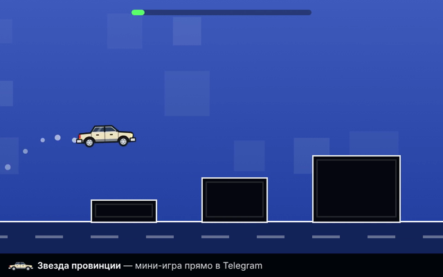

# Звезда провинции: мини-игра в Telegram-боте



Угловатый седан 80-х едет по дороге и перепрыгивает шипы и блоки. Бот на `/start` присылает
зацикленную «гифку» с игрой и кнопку под ней. Кнопка открывает ту же игру как Telegram Mini App,
и в ней уже можно играть самому.

## Как это устроено (и как сделано в том видео)

| Что видно в чате | Что это на самом деле | Где в коде |
|---|---|---|
| Игра «прямо в сообщении» | **MP4 без звука**, отправленное через `sendAnimation`. Telegram показывает его как GIF и крутит по кругу. Интерактива внутри сообщения нет: Telegram не запускает HTML/JS в сообщениях. | `assets/preview.mp4`, `bot/index.js` |
| Подпись-плашка снизу кадра | Нарисована прямо в видео | `--brand` в `scripts/render-preview.js` |
| Кнопка под сообщением со стрелкой ↗ | Inline-кнопка типа `web_app`, открывает Mini App | `keyboard()` в `bot/index.js` |
| Кнопка слева от поля ввода («Catalogue» на видео) | Menu Button бота (`setChatMenuButton`), тоже открывает Mini App | `main()` в `bot/index.js` |
| Сама игра | Обычная веб-страница с `<canvas>` и SDK `telegram-web-app.js` | `webapp/` |

Главный трюк: видео рендерится **из того же кода игры**. Играет автопилот, который заранее
просчитывает уровень, поэтому превью в чате выглядит в точности как настоящая игра.

```
webapp/index.html, game.js     — игра (Mini App): физика, уровень, автопилот, отрисовка машины
scripts/render-preview.js       — headless Chromium + ffmpeg → assets/preview.mp4
scripts/check.js                — проверка: автопилот проходит уровень, игра запускается
bot/index.js                    — бот без зависимостей (Node 20+)
.github/workflows/pages.yml     — автодеплой webapp/ на GitHub Pages
```

## Запуск

1. **Создать бота.** В [@BotFather](https://t.me/BotFather): `/newbot`, сохранить токен.
2. **Опубликовать игру по https** (Telegram открывает Mini App только по https):
   - GitHub Pages: Settings → Pages → Source: **GitHub Actions**, затем влить ветку в `main`.
     Игра появится по адресу `https://<user>.github.io/<repo>/`. Для приватного репозитория
     Pages требует платный план.
   - или перетащить папку `webapp/` в Netlify Drop, Vercel или Cloudflare Pages.
3. **Настроить и запустить бота:**
   ```bash
   cp .env.example .env      # вписать BOT_TOKEN и WEBAPP_URL
   npm run bot               # Node 20+, npm install для бота не нужен
   ```
   Написать боту `/start`.

Бот работает через long polling, поэтому подойдёт любой сервер или VPS (Railway, Render, Fly.io…),
где процесс живёт постоянно.

## Своё превью-видео

```bash
npm install
npx playwright install chromium
npm run render -- --brand "Моя игра — играй прямо в Telegram" --seconds 7
npm run check
```

Параметры: `--seconds`, `--fps`, `--scale` (2 → 1280×800), `--start` (сколько секунд пропустить),
`--seed` (другой уровень), `--brand ""` (без плашки). Если ffmpeg уже установлен в системе
или указан в `FFMPEG_PATH`, пакет `ffmpeg-static` не нужен.

После замены `preview.mp4` бот сам загрузит новый файл: кэш `file_id` привязан к размеру и дате файла.

## Машина

Седан рисуется кодом в `drawCar()` (`webapp/game.js`), без картинок. Цвет кузова, стёкол и хрома
задаётся в объекте `CAR`, например `body: '#b9c0c9'` даст серебристый седан. Хитбокс (`PW`, `PH`) чуть короче
рисунка: касание бампером прощается. Эмблем и названий реальных марок нет, только узнаваемый силуэт эпохи.

## Что можно добавить

- **Таблица рекордов.** Есть встроенная платформа [Telegram Games](https://core.telegram.org/bots/games):
  `/newgame` в BotFather, `sendGame` и `setGameScore`. Сообщение выглядит похоже (GIF + кнопка «Играть»),
  а рекорды друзей Telegram хранит сам.
- **Прямая ссылка** `t.me/<бот>?startapp`: в BotFather → Bot Settings → Configure Mini App.
- **Свои уровни.** Паттерны препятствий лежат в `buildLevel()` (`webapp/game.js`). Автопилот
  сам проверит, что уровень проходим, а если нет, возьмёт следующий seed.
